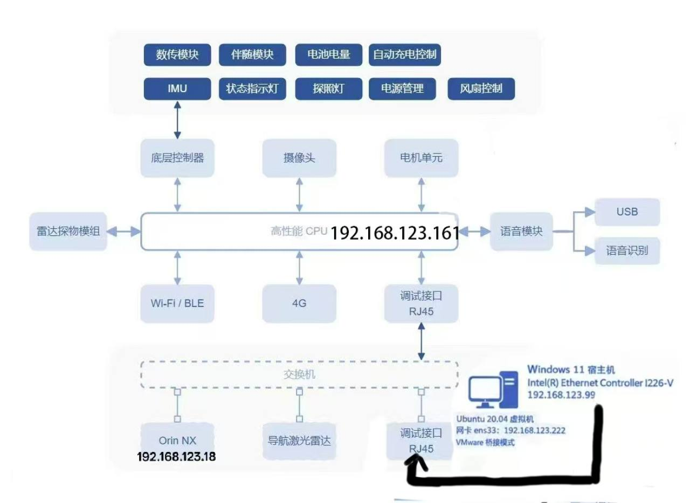

# Ubuntu 虚拟机和 Unitree Go2 EDU 调试记录


## 1. 环境准备
网络逻辑关系如图所示

- 宿主机：Windows 11
- VMware：Workstation Pro 26.0.1（build 25688693）
- 虚拟机：Ubuntu 20.04.6 LTS，2 核、4 GB 内存、40 GB 动态增长磁盘
- 机器狗：Unitree Go2 EDU
- 开发环境：Unitree SDK2 和 Unitree SDK2 Python

虚拟机放在 `D:\VirtualMachines\Ubuntu20.04`，SDK 源码放在 `D:\UnitreeGo2`。Ubuntu 已经能够正常进入桌面，Python 3.8.10 和 SDK 的 Python 模块可以正常使用。

## 2. 网络配置和排障

虚拟机刚装好时使用 VMnet8 的 NAT 网络，Ubuntu 曾获得 `192.168.132.128`，上网测试正常。连接 Go2 时需要使用有线局域网，因此又配置了 VMnet0 桥接网络。

最初的问题是 Ubuntu ping 不通 Go2，ARP 请求也收不到回应。原因是 VMnet0 虽然设置成了桥接模式，但桥接目标没有正确固定到宿主机的物理有线网卡。

最后采用的有效配置是：

- 在 VMware 虚拟网络编辑器中把 VMnet0 设为桥接模式，并手动选择 `Intel(R) Ethernet Controller I226-V`，不使用自动桥接。
- 宿主机有线网卡设为 `192.168.123.99/24`，关闭 DHCP，不设置网关。
- Ubuntu 中连接 Go2 的桥接网卡是 `ens33`，地址为 `192.168.123.222/24`。
- Go2 的地址是 `192.168.123.161`。

修改后实测结果如下：

```text
Ubuntu 客户机 -> Go2 192.168.123.161
3 packets transmitted, 3 received, 0% packet loss
rtt min/avg/max = 0.627/0.700/0.741 ms

ens33 = 192.168.123.222/24
Windows 宿主机 -> Go2：连通
```

因此，这次网络故障最终是通过手动指定 VMnet0 的桥接网卡解决的。

VMnet8 的 NAT 功能和虚拟机初装时的联网已经验证过，但当前虚拟机配置记录中只确认到一张桥接网卡。第二张连接 VMnet8 的虚拟网卡是否仍然挂载、能否与桥接网卡同时使用，待确认，不能写成已经完成。

### 运行前的目录准备

在 Ubuntu 终端中执行：
ifconfig
查看输出中的网卡名称和 IP 地址。找到显示 `192.168.123.222` 的网卡，其名称为 `ens33`，因此后续运行机器狗 SDK 示例时使用 `ens33` 作为网络接口参数。

在 Ubuntu 终端中，进入 Unitree SDK2 Python 的目录：
执行：
cd ~/unitree_sdk2_python

进入该目录后，就可以使用相对路径运行 SDK 中的示例程序。后续运动控制和灯光亮度测试均通过 Ubuntu 终端执行，并使用 `ens33` 作为连接机器狗的网卡名称。

## 3. SDK 运动控制测试

实际运行的是 Unitree SDK2 Python 的 Go2 运动控制交互菜单：

`unitree_sdk2_python/example/go2/high_level/go2_sport_client.py`

使用连接机器狗的 `ens33` 网卡启动：

python3 ./example/go2/high_level/go2_sport_client.py ens33

程序进入交互式测试菜单后，实际完成了下面两个动作：

1. 输入 `2`，选择 `stand_down`，Go2 成功趴下。
2. 输入 `1`，选择 `stand_up`，Go2 成功站立。

## 4. 灯光亮度控制测试

灯光测试实际运行的是 Unitree SDK2 Python 的官方示例，没有把未运行的 C++ 示例算入测试记录：

`unitree_sdk2_python/example/vui_client/vui_client_example.py`

实际使用的命令为：


python3 ./example/vui_client/vui_client_example.py ens33


程序先读取当前亮度，然后依次把亮度设置为 1 到 10，最后设置为 0。该示例已经成功运行，Go2 的灯光亮度控制测试完成。

相关代码为：

```python
ChannelFactoryInitialize(0, sys.argv[1])

client = VuiClient()
client.SetTimeout(3.0)
client.Init()

code, level = client.GetBrightness()
for i in range(1, 11):
    code = client.SetBrightness(i)
    time.sleep(1)
code = client.SetBrightness(0)
```

## 5. 目前进度

- VMware 和 Ubuntu 20.04 虚拟机安装。
- Ubuntu 基础开发环境和 Unitree SDK2 Python 配置。
- Ubuntu、宿主机与 Go2 的有线网络连通性验证。
- 通过 SDK 菜单执行 `stand_down`，Go2 成功趴下。
- 通过 SDK 菜单执行 `stand_up`，Go2 成功站立。
- 使用 Python VUI 示例完成灯光亮度控制。

