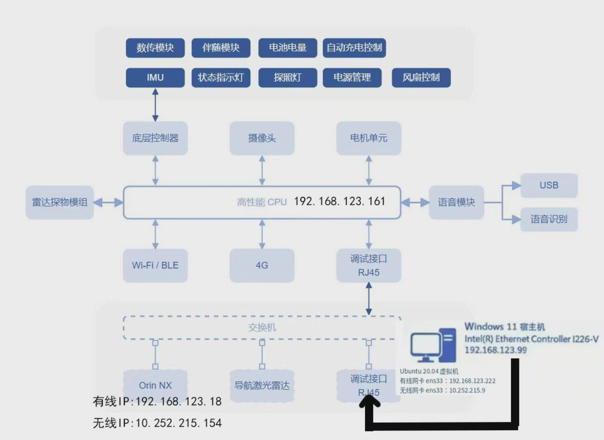

# Unitree Go2 EDU 无线网卡调试记录

> 接续 [《有线连接与 SDK 控制测试》](./有线连接与SDK控制测试.md)。前一份记录的是**有线**方案（虚拟机 `ens33 = 192.168.123.222`，经 VMnet0 桥接宿主机有线网卡连接 Go2）。
> 本文记录将控制链路改为**手机热点无线**的完整操作过程，按实际操作顺序编排，可作为复现步骤参考。
>
> 说明：文中热点名称统一以 `LabHotspot` 代指，MAC 地址已做部分遮盖处理；命令中的机器狗地址统一用 `$ROBOT_IP` 表示（设置方法见 2.1）。实际执行时请替换为现场环境对应的值。

**网络拓扑图（本次无线网卡调试标注）**



> **图片说明**：本图在原有网络拓扑图基础上，补充了本次无线测试的 IP 信息。图中地址是当时实验环境的记录，**不是所有设备都通用或始终不变的地址**。尤其是拓展坞无线 IP `10.252.215.154` 和 Ubuntu 虚拟机无线桥接 IP `10.252.215.9`，均为当时热点 DHCP 分配的地址，重新连接后可能变化；虚拟机 `ens33` 的有线与无线地址对应不同测试阶段，并非同时使用。实际操作请以现场查询结果为准。

## 0. 概述与结论

**适用情况**：机器狗插了 USB 无线网卡、想通过手机热点远程连上，不再拖着网线。

**本文结论**：

| 事项 | 状态 |
|---|---|
| 机器狗无线网卡识别、驱动、射频 | ✅ 已实测正常 |
| 机器狗连上手机热点、拿到 IP | ✅ 已实测（DHCP 有抖动，需要重试） |
| VMware 桥接无线网卡 | ✅ 已实测可行（不是常见说法里的"Wi-Fi 不能桥接"） |
| 虚拟机拿到热点 IP、与机器狗双向 ping / SSH | ✅ 已实测 |
| 虚拟机里**直接运行官方 `go2_sport_client.py`** | ❌ 不能，原因见附录 A（不是网络没通） |
| 通过 SSH 调用机器狗内部的控制脚本 | ✅ 已实测，`standdown` 回执 `status_code=0`，机器狗实际趴下 |

**结论**：无线链路本身可用，SSH 可正常登录；官方 SDK2 无法直接运行，原因是其目标 DDS 服务不在 Wi-Fi 网段内。

**阅读建议**：第 1 节说明设备与地址的对应关系，第 2 节为流程总览，第 3～12 节按顺序操作，故障排查见第 13 节；技术分析见附录 A，尚未验证的事项见附录 C。

---

## 1. 先认设备：网卡、接口、地址

本节建议在操作前通读。后续步骤中最容易出现的两类错误是：在错误的设备上修改了错误的网卡；直接照抄动态分配的地址。

### 1.1 涉及的设备与各自的网卡

| 机器 | 操作系统 | 网卡名 | 说明 |
|---|---|---|---|
| Windows 宿主机 | Windows 11 | `WLAN` | 无线网卡 MediaTek Wi-Fi 7 MT7925 |
| Windows 宿主机 | Windows 11 | `以太网` | 有线网卡 Intel I226-V，只有线调试时用 |
| Ubuntu 虚拟机 | Ubuntu 20.04.6 | `ens33` | 桥接网卡（VMnet0 → MT7925），连热点用这张 |
| Ubuntu 虚拟机 | Ubuntu 20.04.6 | `ens37` | NAT 网卡（VMnet8），虚拟机自己的上网通道 |
| 机器狗 Docking Station（拓展坞，Jetson Orin） | Ubuntu 20.04.6 | `wlan0` | USB 无线网卡 Realtek RTL8188ETV |
| 机器狗 Docking Station（拓展坞） | Ubuntu 20.04.6 | `eth0` | 有线网口，连机器狗内部网 |
| 机器狗机载电脑（Go2 本体） | — | — | `192.168.123.161`，运行运动控制与 DDS 服务 |

机器狗这边涉及**两块计算单元**，本文后续步骤都在第一块上执行：

- **拓展坞（Docking Station）**：`192.168.123.18`，可 `ssh unitree@192.168.123.18` 登录。本次插的 USB 无线网卡、`unitree_sdk2_python` 都在它上面。
- **机载电脑（Go2 本体）**：`192.168.123.161`，运动控制与 DDS 服务在它上面。宇树官方 Quick Start 只要求从电脑 `ping 192.168.123.161` 确认连通，未要求 SSH 到它；本次实测它的 22 端口是 refused。（依据见附录 D）

### 1.2 地址对照表（重点：哪些是动态的）

| 设备 | 接口 | 地址 | 谁分配的 | 能不能照抄 |
|---|---|---|---|---|
| 手机热点 | — | 网关/DHCP `10.252.215.40` | 手机 | 会变，**不要写死** |
| 机器狗 | `wlan0` | `10.252.215.154`（本次） | 热点 DHCP | ❌ 动态，每次可能不同 |
| Windows | `WLAN` | `10.252.215.254`（本次） | 热点 DHCP | ❌ 动态 |
| Ubuntu 虚拟机 | `ens33` | `10.252.215.9`（本次） | 热点 DHCP | ❌ 动态 |
| Ubuntu 虚拟机 | `ens37` | `192.168.132.129` | VMware NAT 的 DHCP | ❌ 动态 |
| 机器狗拓展坞 | `eth0` | `192.168.123.18` | 出厂静态配置 | ✅ 固定 |
| 机器狗机载电脑（Go2 本体） | — | `192.168.123.161` | 出厂静态配置 | ✅ 固定，不会变 |
| 控制电脑一侧 | 宿主机 `以太网` 或虚拟机 `ens33` | `192.168.123.222` | 手动设置（见步骤 0） | ❌ 不是机器狗地址，且两者不可同时使用 |

**三个需要特别注意的问题**：

1. **`192.168.123.222` 不是机器狗的地址。** 它是"控制电脑"这一侧手动设置的地址：前一版记录分配给虚拟机 `ens33`，本次有线阶段分配给宿主机 `以太网`。两种用法是同一地址在不同时期的不同配置，**不应同时存在**（会地址冲突）。机器狗固定占用的是 `.18`（拓展坞，可 SSH）和 `.161`（机载电脑，不开放 SSH）。
2. **`10.252.215.x` 全是手机热点 DHCP 分的**，本文写的具体数字只是本次结果。每台设备第一次用都要自己查一遍。
3. 机器狗的无线地址每次重连都可能变化。可使用主机名简化操作：机器狗上的 `avahi-daemon` 处于运行状态，`ping ubuntu.local` 可通；但 Ubuntu 有时会优先尝试 IPv6 导致超时，命令中加 `-4` 更为稳妥。

---

## 2. 操作总览

```
[机器狗拓展坞] 步骤1 确认网卡 → 步骤2 看网络管理状态 → 步骤3 连热点 → 步骤4 拿到 IP
                                                                        ↓
[Windows]      步骤5 确认自己在同一个热点
                                                                        ↓
[VMware]       步骤6 VMnet0 桥接到无线网卡
                                                                        ↓
[Ubuntu 虚拟机] 步骤7 ens33 改 DHCP 拿热点地址 → 步骤8 SSH 连机器狗
                                                                        ↓
[Ubuntu → 机器狗] 步骤9 控制测试
```

每个步骤均标注了执行环境，操作前请确认当前终端所在的设备与步骤标注一致。

### 2.1 命令里的地址约定

机器狗的无线地址由热点 DHCP 分配，**每次实验都可能不同**（本文实测为 `10.252.215.154`，仅作示例）。为避免照抄过期地址，下面所有涉及该地址的命令统一写成变量 `$ROBOT_IP`，执行前先在虚拟机终端设置一次：

```bash
# 环境：Ubuntu 虚拟机终端
ROBOT_IP=10.252.215.154  # 替换为步骤 4 实际查到的地址
echo "$ROBOT_IP"                        # 确认变量已生效
```

注意：变量只在当前终端会话内有效，**新开终端需要重新设置**。也可以直接用主机名 `ROBOT_IP=ubuntu.local`，此时 SSH 建议加 `-4`（见第 1 节第 3 条）。

---

## 3. 步骤 0（前置）：先建立进入机器狗的通道

修改无线配置必须在机器狗上执行，因此**首次操作前需要先建立一条进入机器狗的通道**。可选方式有两种：

### 3.1 有线方式（建议首次使用）

> 地址选择说明：以下命令把宿主机有线网卡设为 `192.168.123.222`，与本次实际操作一致。前一版记录中宿主机用的是 `192.168.123.99`、虚拟机用 `.222`。若同一台机器上虚拟机也桥接在有线网卡上，两者不能同时使用 `.222`，此时建议宿主机改用 `192.168.123.99`。该并存场景本次未验证，**待核实**。

> 环境：Windows 宿主机
> 输入位置：**管理员** PowerShell 或命令提示符

```powershell
netsh interface ipv4 set address name="以太网" static 192.168.123.222 255.255.255.0
```

> 环境：Windows 宿主机
> 输入位置：普通 PowerShell

```powershell
ping 192.168.123.18
ssh unitree@192.168.123.18
```

**预期**：能 ping 通（`192.168.123.18` 有回应），SSH 登录后 `hostname` 返回 `ubuntu`，`uname -m` 返回 `aarch64`。

**如果 ping 不通**，先看这三条：

```powershell
netsh interface ipv4 show config name="以太网"
route print -4
arp -a
```

- `IP Address` 如果是 `169.254.x.x`，说明还在 DHCP 状态、没拿到地址 → 上面的 `netsh` 命令没生效。
- 路由表里没有 `192.168.123.0/24` → 地址没设上。
- `arp -a` 里 `192.168.123.222` 指向 `00-0c-29-xx-xx-xx`（VMware 的 OUI）属于正常残留，不影响。

**恢复方式**（需改回自动获取时）：

```powershell
netsh interface ipv4 set address name="以太网" source=dhcp
```

> 补充：本机环境中 Windows 的 ICMP 曾被拦截（连网关亦无回应，但 TCP 正常）。若 ping 失败而 SSH 可连接，以 SSH 结果为准。

### 3.2 已经知道机器狗无线 IP / 主机名

> 环境：Ubuntu 虚拟机终端（需先按 2.1 设置 ROBOT_IP 变量）

```powershell
ssh unitree@$ROBOT_IP
# 或者
ssh -4 unitree@ubuntu.local
```


### 3.3 使用 MobaXterm 连接（可选）

MobaXterm 是 Windows 下的远程连接工具，可以通过 SSH 登录机器狗拓展坞的 Linux 系统并执行命令，也支持通过 SFTP 传输文件。

使用时新建 SSH 会话，填写拓展坞当前可 SSH 访问的 IP 地址、用户名 `unitree` 和端口 `22` 即可连接。

本次实验实际使用的是 Ubuntu 虚拟机终端执行 SSH 命令，没有使用 MobaXterm。它可以作为 Windows 下的另一种连接方式，供后续实验参考。

---

## 4. 步骤 1（机器狗拓展坞）：确认无线网卡被识别

> 环境：机器狗拓展坞（`unitree@192.168.123.18` 或 `unitree@<无线IP>`）
> 输入位置：拓展坞终端
> 性质：只读，不改任何配置

```bash
lsusb
ip -br link
lsmod | grep -iE "rtl|cfg80211|mac80211"
ethtool -i wlan0
rfkill list
```

**本次实测的预期输出**：

```
lsusb:  Bus 001 Device 002: ID 0bda:0179 Realtek Semiconductor Corp.
        RTL8188ETV Wireless LAN 802.11n Network Adapter

ip -br link:  wlan0   DOWN   04:ec:bb:xx:xx:xx <BROADCAST,MULTICAST>

lsmod:  r8188eu   389120  0
        lib80211  16384   1 r8188eu
        cfg80211 724992   1 r8188eu

ethtool -i wlan0:
        driver: r8188eu
        bus-info: 1-2:1.0
```

**成功标志**：`wlan0` 出现在网卡列表里，`ethtool -i wlan0` 能读出 `driver: r8188eu`。

**失败排查**：

| 现象 | 原因 | 处理 |
|---|---|---|
| 没有 `wlan0` | USB 网卡没插好或没识别 | `lsusb` 看有没有 `0bda:0179`；换 USB 口（用 USB 2.0 口更稳） |
| 有 `wlan0` 但 `ethtool -i` 报错 | 驱动没绑上 | `dmesg \| grep -i rtl` 看加载过程，必要时重新插拔网卡 |
| `lsmod` 里没有 `r8188eu` | 模块没加载 | `sudo modprobe r8188eu` |
| `rfkill list` 显示 `Soft blocked: yes` | 被软件禁用 | `sudo rfkill unblock wifi` |

> `wlan0` 初始是 `DOWN` 属于正常，还没连任何 AP。

---

## 5. 步骤 2（机器狗拓展坞）：看一眼网络管理状态

> 环境：机器狗拓展坞
> 输入位置：拓展坞终端
> 性质：只读

```bash
nmcli device status
nmcli -f NAME,TYPE,DEVICE connection show
systemctl is-active NetworkManager
```

**本次实测的预期输出**：

```
DEVICE   TYPE      STATE         CONNECTION
eth0     ethernet  connected     Wired connection 1
wlan0    wifi      disconnected  --
docker0  bridge    connected     docker0

NAME                TYPE
Wired connection 1  ethernet
Wired connection 2  ethernet
```

**成功标志**：`NetworkManager` 是 `active`，`wlan0` 状态是 `disconnected`（而不是 `unmanaged` 或 `unavailable`）。

**本步骤需要特别确认**：`connection show` 中**没有**任何 `wifi` 类型的连接，说明机器狗此前未保存过该热点的配置，因此下一步是新建连接而非修改已有连接。

**失败排查**：

| 现象 | 原因 | 处理 |
|---|---|---|
| `wlan0` 是 `unmanaged` | NetworkManager 没接管这块网卡 | 检查 `/etc/NetworkManager/NetworkManager.conf`；本次记录里没遇到过，属于待补充 |
| 后面 `nmcli` 报 `not authorized to control networking` | 走 SSH 时 polkit 不允许普通用户改网络 | 所有 `nmcli` 前面都加 `sudo`（本文后续命令均已加） |

---

## 6. 步骤 3（机器狗拓展坞）：连接手机热点

> 环境：机器狗拓展坞
> 输入位置：拓展坞终端
> 性质：**修改**（会在机器狗上新增一条 Wi-Fi 连接配置）

### 6.1 确认可扫描到目标热点

```bash
sudo nmcli -f SSID,BSSID,CHAN,FREQ,SIGNAL,SECURITY device wifi list
```

**本次实测**：

```
SSID         BSSID              CHAN  SIGNAL  SECURITY
LabHotspot  5E:42:08:XX:XX:XX  6     100     WPA2
```

> 说明：本文统一以 `LabHotspot` 代指实验用热点。实际执行时以 `nmcli ... device wifi list` 的扫描结果为准，后续命令中的名称需与之一致。

若扫描不到该热点：确认热点工作在 2.4 GHz 频段、机器狗与手机距离足够近，并执行 `sudo nmcli device wifi rescan` 重新扫描。

### 6.2 连接

```bash
sudo nmcli --ask device wifi connect "LabHotspot"
```

- `--ask` 会让终端提示你**手动输入热点密码**，密码不会留在 shell 历史里。这是推荐写法。
- 如果先提示 `[sudo] password for unitree:`，那是机器的 sudo 密码。

**成功时的输出**：

```
Device 'wlan0' successfully activated with '<uuid>'.
```

### 6.3 本次实际遇到的失败：握手成功但 DHCP 超时

第一次连的时候，密码是对的，但卡在拿 IP：

```
device (wlan0): supplicant interface state: 4-way handshake -> completed
device (wlan0): Activation: (wifi) Stage 2 of 5 successful.
                Connected to wireless network "LabHotspot"
dhcp4 (wlan0): activation: beginning transaction (timeout in 45 seconds)
dhcp4 (wlan0): request timed out
device (wlan0): state change: ip-config -> failed (reason 'ip-config-unavailable')
```

**判断方法**：出现 `4-way handshake -> completed` 说明认证已通过、密码无误，问题出在 DHCP 阶段，无需再排查密码。

**处理方式**：直接重试，期间不需要修改任何配置。本次在第 3 次尝试时成功：

```
=== 尝试 1 ===  Error: Timeout expired (45 seconds)
=== 尝试 2 ===  Connection successfully activated（未及时拿到 IP）
=== 尝试 3 ===  Connection successfully activated
IP4.ADDRESS[1]: 10.252.215.154/24
```

重试命令（已经建有连接配置后不用再输密码）：

```bash
sudo nmcli connection up "LabHotspot"
```

**失败排查**：

| 现象 | 原因 | 处理 |
|---|---|---|
| 报 `Secrets were required, but not provided` | 密码输入有误 | 先删除该连接再重新建立：`sudo nmcli connection delete "LabHotspot"` |
| `4-way handshake -> completed` 但 DHCP 超时 | 驱动 + Android 热点首包丢失（本次原因） | 重试 2～3 次 |
| 完全扫描不到 SSID | 频段、距离或热点未广播 | 在手机端确认热点已开启，并缩短距离 |
| `not authorized` | polkit 限制 | 命令前加 `sudo`（本文已加） |

### 6.4 恢复

不想保留这条 Wi-Fi 配置时：

```bash
sudo nmcli connection delete "LabHotspot"
```

---

## 7. 步骤 4（机器狗拓展坞）：确认真的拿到 IP

> 环境：机器狗拓展坞
> 输入位置：拓展坞终端
> 性质：只读

```bash
ip -br -4 addr show wlan0
nmcli -f GENERAL.STATE,IP4.ADDRESS,IP4.GATEWAY device show wlan0
ip route
```

**本次实测**：

```
wlan0   UP   10.252.215.154/24
GENERAL.STATE: 100 (connected)
IP4.ADDRESS[1]: 10.252.215.154/24
IP4.GATEWAY: 10.252.215.40
```

**成功标志**：`wlan0` 是 `UP` 且带 `10.252.215.x` 地址，状态 `100 (connected)`。

请记录本次取得的地址，后续 SSH 连接需要使用。该地址为动态分配，重连后可能变化。

可进一步验证外网连通性（连通即说明热点链路完整）：

```bash
ping -c 2 10.252.215.40
curl -sI https://pypi.org/simple/ | head -3
```

---

## 8. 步骤 5（Windows）：确认宿主机在同一个热点上

> 环境：Windows 宿主机
> 输入位置：**管理员** PowerShell（`netsh wlan show interfaces` 需要管理员权限）

```powershell
netsh wlan show interfaces
ipconfig
```

**本次实测**：

```
State         : connected
SSID          : LabHotspot
AP BSSID      : 5e:42:08:xx:xx:xx
Band          : 2.4 GHz    Channel : 6
Signal        : 95%        Rssi : -33
Authentication: WPA2-Personal
```

**成功标志**：**BSSID 和机器狗扫到的一致**（本次都是 `5E:42:08:XX:XX:XX`）。只看 SSID 不够，同一个 SSID 可能有多个 AP。

同时记录 Windows 的无线地址（本次 `10.252.215.254`），后续可用于核对网段。

---

## 9. 步骤 6（VMware）：把 VMnet0 桥接到无线网卡

> 环境：VMware Workstation（Windows 宿主机上）
> 输入位置：图形界面

### 9.1 先确认要桥接哪一张网卡

这台机器上有**多个** MT7925 实例：`WLAN`、`WLAN 2`、`WLAN 3`、`WLAN 4`、`WLAN 5`。其中只有一个是真正在用的。

> 环境：Windows 宿主机
> 输入位置：普通 PowerShell

```powershell
netsh interface ipv4 show config name="WLAN"
```

看到 `10.252.215.x` 地址的那一张才是活动的（本次是 `WLAN`，MAC `44:F7:9F:xx:xx:xx`）。桥接目标必须是它。

### 9.2 设置桥接

1. VMware Workstation → `编辑` → `虚拟网络编辑器`
2. 选中 `VMnet0`
3. 选「桥接模式」
4. **不要用「自动」，手动在列表里选中那张活动的无线网卡**
5. 点「确定」

然后打开虚拟机设置 → `网络适配器` → 确认第一张网卡接的是「桥接模式（自动）/VMnet0」。

### 9.3 怎么知道桥接真的通了

无需依赖 VMware 界面显示的连接状态，直接在虚拟机内检查是否取得热点地址（见下一步）。

**补充说明**：常见说法认为 VMware 无法桥接无线网卡。本次实测表明桥接可用，虚拟机首次尝试即取得热点地址；问题不在桥接，而在机器狗侧（见附录 A）。

---

## 10. 步骤 7（Ubuntu 虚拟机）：让 ens33 从热点拿地址

> 环境：Ubuntu 虚拟机
> 输入位置：虚拟机的终端窗口
> 性质：**修改**（会改掉 `ens33` 的静态地址，务必先备份）

### 10.1 查看当前配置

```bash
ip -br -4 addr
ip route
nmcli -f NAME,DEVICE,TYPE connection show
```

**本次改之前的实测**（和前一版记录一致）：

```
ens33   UP   192.168.123.222/24     ← 前一版记录中设置的静态地址，无线环境下不可用
ens37   UP   192.168.132.129/24     ← NAT
default via 192.168.132.2 dev ens37 proto dhcp metric 101
```

### 10.2 备份（必须执行）

`ens33` 的静态地址**不在 netplan 中**，而在 NetworkManager 的连接配置 `Wired connection 1` 内，因此两处均需备份：

```bash
B=~/net-backup-$(date +%Y%m%d-%H%M%S)
sudo mkdir -p "$B"
sudo cp -a /etc/netplan "$B/"
sudo cp -a /etc/NetworkManager/system-connections "$B/nm-connections"
sudo chown -R $USER:$USER "$B"
find "$B" -type f
```

**成功标志**：`netplan/01-network-manager-all.yaml` 与 `nm-connections/Wired connection 1.nmconnection` 两个文件均已复制到备份目录。

### 10.3 改成 DHCP

```bash
sudo nmcli connection modify "Wired connection 1" ipv4.method auto ipv4.addresses "" ipv4.gateway "" ipv4.dns ""
sudo nmcli connection up "Wired connection 1"
```

### 10.4 预期结果

```bash
ip -br -4 addr show ens33
```

```
ens33   UP   10.252.215.9/24
```

**成功标志**：`ens33` 拿到 `10.252.215.x`（和手机热点同网段）。

### 10.5 失败排查

| 现象 | 原因 | 处理 |
|---|---|---|
| `ens33` 还是老地址 | 连接没重新激活 | `sudo nmcli connection down "Wired connection 1" && sudo nmcli connection up "Wired connection 1"` |
| 拿到 `169.254.x.x` | 桥接没通 / 桥接目标选错网卡 | 回到步骤 6，确认桥接的是活动那张 MT7925 |
| `ens33` 直接没有地址 | 热点连不上了 | 在 Windows 上确认热点还在连（步骤 5） |
| 改了 `ens37` 导致虚拟机没网 | 改错连接了 | 本文只动 `Wired connection 1`（`ens33`），`Wired connection 2`（`ens37`）不要碰 |

### 10.6 恢复成有线配置

```bash
sudo nmcli connection modify "Wired connection 1" ipv4.method manual ipv4.addresses 192.168.123.222/24
sudo nmcli connection up "Wired connection 1"
```

或直接使用 10.2 的备份覆盖恢复。

---

## 11. 步骤 8（Ubuntu 虚拟机）：SSH 连上机器狗

> 环境：Ubuntu 虚拟机
> 输入位置：虚拟机终端

```bash
# 环境：Ubuntu 虚拟机终端（先按 2.1 设置好 $ROBOT_IP）
ssh unitree@$ROBOT_IP
```

**预期**：

```
unitree@ubuntu:~$
```

先确认以下三项均正常：

```bash
ping -c 3 $ROBOT_IP
ssh unitree@$ROBOT_IP 'hostname; whoami; ip -br -4 addr show wlan0'
```

**成功标志**：`hostname` 返回 `ubuntu`，`whoami` 返回 `unitree`，`wlan0` 上带着热点地址。

**常见失败**：

| 现象 | 原因 | 处理 |
|---|---|---|
| `Connection timed out` | 机器狗无线 IP 变了 | 重新走步骤 4 查 IP；或用 `ssh -4 unitree@ubuntu.local` |
| `ubuntu.local` 解析到 IPv6 后卡住 | mDNS 返回 IPv6，网络里 IPv6 不通 | 加 `-4` 强制 IPv4 |
| `Permission denied` | 用户名/密码不对 | 用户名是 `unitree`（不是 `ubuntu`） |
| `Host key verification failed` | 机器狗重装/换过密钥 | `ssh-keygen -R <IP>` 清掉旧记录 |

---

## 12. 步骤 9（Ubuntu → 机器狗）：控制测试

需要区分两条路线：一条本次已跑通，另一条尚未跑通。

### 12.1 路线 A：SSH 调用机器狗内部的控制脚本（已实测成功）

**原理**：机器狗内部的 DDS 网络只在机器狗里可访问，那就让机器狗自己执行控制，虚拟机通过 SSH 下命令。

**可行原因**：机器狗拓展坞上已具备 ROS2 Foxy、CycloneDDS 工作区与 `unitree_api` 消息包源码；拓展坞与机载电脑 `192.168.123.161` 同处内部网，其 DDS 可直接看到控制话题（实测可见 `/api/sport/request` 等 121 个话题，且该话题存在 1 个订阅者）。虚拟机只需通过 SSH 调用拓展坞。

#### 12.1.1 在机器狗上编译消息包（一次性）

> 环境：先从 Ubuntu 虚拟机开始
> 输入位置：虚拟机终端（先登录机器狗）

```bash
# 环境：Ubuntu 虚拟机终端
ssh unitree@$ROBOT_IP
```

登录成功后，提示符为 `unitree@ubuntu:~$`，**以下命令全部在拓展坞终端执行**：

```bash
# 环境：拓展坞终端
ls -l /home/unitree/go2_ws/src 2>/dev/null    # 目录已存在时，先确认没有同名包
mkdir -p /home/unitree/go2_ws/src
cp -r /home/unitree/unitree_api_src /home/unitree/go2_ws/src/unitree_api
cd /home/unitree/go2_ws
source /opt/ros/foxy/setup.bash
colcon build --packages-select unitree_api
```

**预期**：

```
Starting >>> unitree_api
Finished <<< unitree_api [17.8s]
Summary: 1 package finished [21.9s]
```

**成功标志**：

```bash
source /opt/ros/foxy/setup.bash
source /home/unitree/go2_ws/install/setup.bash
ros2 pkg list | grep unitree     # 应输出 unitree_api
```

> 本步骤使用机器狗上已有的源码，不涉及任何下载。

#### 12.1.2 把控制脚本传到机器狗（一次性）

脚本源码见附录 E。整个流程分三步，注意每一步执行的终端不同。

**第一步：在虚拟机本地创建两个文件**

> 环境：Ubuntu 虚拟机
> 输入位置：虚拟机终端

```bash
# 环境：Ubuntu 虚拟机终端
mkdir -p ~/go2ctl && cd ~/go2ctl

cat > go2ctl.sh <<'EOF'
# ← 把附录 E.1 的内容整段粘贴到这里（从 #!/bin/bash 那一行开始）
EOF

cat > go2ctl.py <<'PY'
# ← 把附录 E.2 的内容整段粘贴到这里（从 #!/usr/bin/env python3 那一行开始）
PY

ls -l ~/go2ctl
```

**预期**：`~/go2ctl` 下出现 `go2ctl.sh` 和 `go2ctl.py` 两个文件。

> 如果不想用 heredoc，也可以执行 `nano ~/go2ctl/go2ctl.py`，把附录 E 的内容粘贴进去后保存（确保是 UTF-8 编码）。

**第二步：用 scp 传到机器狗**

> 环境：Ubuntu 虚拟机
> 输入位置：虚拟机终端

```bash
# 环境：Ubuntu 虚拟机终端
scp ~/go2ctl/go2ctl.sh ~/go2ctl/go2ctl.py unitree@$ROBOT_IP:/home/unitree/
```

**预期**：两行传输进度（例如 `go2ctl.sh  100%  328  0.3KB/s`），无报错。
若提示 `Permission denied`，检查用户名是否为 `unitree`、密码是否正确。

**第三步：在机器狗上赋权并自检**

> 环境：机器狗拓展坞
> 输入位置：拓展坞终端（`ssh unitree@$ROBOT_IP` 登录后）

```bash
# 环境：拓展坞终端
chmod +x /home/unitree/go2ctl.sh /home/unitree/go2ctl.py
/home/unitree/go2ctl.sh list
```

**预期**：打印出可用动作表（`damp`、`standup`、`standdown`、`balance`、`sit` 等）。

#### 12.1.3 使用

> 环境：Ubuntu 虚拟机
> 输入位置：虚拟机终端

```bash
ssh unitree@$ROBOT_IP '/home/unitree/go2ctl.sh standdown'
```

> 注意：**命令必须以 `ssh unitree@<IP>` 开头**。若省略 `ssh`，该行会被当作虚拟机本地命令执行，并报 `command not found`。

**预期输出**：

```
已发送: standdown (api_id=1005, param={})
回执: status_code=0  成功
```

**本次实测结果**（仅列实际执行过的动作）：

| 命令 | api_id | 回执 | 机器狗实际反应 |
|---|---|---|---|
| `standdown` | 1005 | `status_code=0` | 成功趴下（有录像留存） |
| `standup` | 1004 | 未采集 | 已执行并成功站立（有录像，由操作者确认） |
| `damp` | 1001 | 未采集 | 进入阻尼状态，姿势与 `standdown` 的趴下不同；之后执行 `recover` 才恢复站立 |
| `recover` | 1006 | 未采集 | 成功恢复站立（由操作者确认） |
| `stop` | 1003 | `status_code=-1` | 被拒绝，未观察到动作；当时机器狗处于趴姿 |

> **关于 `damp` 与 `standdown` 的区别**
>
> 官方资料把 `damp` 描述为"阻尼模式 / 软趴"，把 `standdown` 描述为趴下。本次实测中，`damp` 执行后机器狗确实进入了阻尼状态，但**姿势与 `standdown` 的趴下姿势不同**，之后执行 `recover` 才恢复站立。
>
> 因此本文的写法是：
> - `damp` 与 `standdown` **不是同一个效果**；需要机器狗趴下时应使用 `standdown`；
> - `damp` 之后的姿态为什么与 `standdown` 不同，本次**没有记录执行时的初始姿态与电量**，无法判断是否与初始状态有关，**待核实**；
> - `damp` 之后如需站立，按本次操作执行 `recover`。

**回执含义**：`0` 表示机器狗已接受并执行；`-1` 表示被拒绝（通常是当前姿态或模式不允许该指令）。回执来自机器狗的响应，并非脚本本地判断结果。

**完整动作表**：

| 命令 | api_id | 作用 |
|---|---|---|
| `go2ctl.sh standup` | 1004 | 站起 |
| `go2ctl.sh standdown` | 1005 | 趴下 |
| `go2ctl.sh balance` | 1002 | 平衡站立 |
| `go2ctl.sh sit` | 1009 | 坐下 |
| `go2ctl.sh risesit` | 1010 | 从坐姿起身 |
| `go2ctl.sh damp` | 1001 | 阻尼模式（官方定义；执行后姿势与 `standdown` 不同，需 `recover` 恢复站立） |
| `go2ctl.sh recover` | 1006 | 恢复站立（本次实测有效） |
| `go2ctl.sh stop` | 1003 | 停止移动 |
| `go2ctl.sh api <id> '{...}'` | 自定义 | 直接发任意 api_id |

> 上表中 `standdown`、`standup`、`damp`、`recover`、`stop` 五个动作在本次实验中执行过（其中 `standup`、`damp`、`recover` 未采集到回执，由录像与操作者确认）。其余动作（`balance`、`sit`、`risesit`）**均未实测**，其实际行为与安全性未经验证，不应直接当作可用功能使用。

#### 12.1.4 安全提醒

- 发送任何运动指令前，确认机器狗周围留有 1 米以上空间、不处于桌沿、四腿无卡阻，并确保操作者能随时物理接触设备。
- `damp` 只作阻尼处理，姿势与 `standdown` 的趴下不同；执行后如需站立，使用 `recover`（本次实测有效）。
- 机器狗处于趴姿或侧翻状态时，运动类指令可能被拒绝（本次 `stop` 在趴姿下返回 `status_code=-1`）；执行前先确认当前姿态。

#### 12.1.5 清理（可选）

`go2_ws` 是本次新建的编译工作区，但无法排除后来有人往里面放了别的包，所以**不建议直接 `rm -rf` 整个目录**。先确认内容：

```bash
# 环境：拓展坞终端
ls -l /home/unitree/go2_ws/src
```

确认 `src` 下只有本次复制的 `unitree_api` 后，按顺序删除：

```bash
# 环境：拓展坞终端
# 1) 删除本次复制的源码包
rm -rf /home/unitree/go2_ws/src/unitree_api
# 2) 删除该包对应的构建与安装产物（只删 unitree_api 这一部分）
rm -rf /home/unitree/go2_ws/build/unitree_api /home/unitree/go2_ws/install/unitree_api
# 3) 目录空了再整体移除；非空则保留（rmdir 只删空目录，不会误删内容）
rmdir /home/unitree/go2_ws/src /home/unitree/go2_ws/build /home/unitree/go2_ws/install /home/unitree/go2_ws 2>/dev/null || echo "目录非空，已保留"
# 4) 删除控制脚本
rm -f /home/unitree/go2ctl.py /home/unitree/go2ctl.sh
```

> - 第 3 步用的是 `rmdir`，只能删空目录；只要 `go2_ws` 里还有别人的文件，就会提示"目录非空，已保留"，不会被误删。
> - 如果 `go2_ws` 在本次操作前**就已存在**（不是新建的），跳过第 3 步，只做第 1、2、4 步。

### 12.2 路线 B：直接运行官方 SDK2 示例（本次**没有**跑通）

**现象**：在虚拟机里运行官方示例，菜单能正常显示，选动作后报错：

```bash
cd ~/unitree_sdk2_python
python3 ./example/go2/high_level/go2_sport_client.py ens33
```

```
[ClientStub] send request error. id: ...
```

**原因**（详细证据见附录 A）：这个报错不是"网络不通"，而是"对面没有 DDS 对端"。机器狗的运动服务在机器狗内部网 `192.168.123.0/24` 上，Wi-Fi 网卡那一侧没有任何 DDS 参与者。

**因此**：调整 IP、路由或组播参数均无法解决该问题，这属于拓扑层面的问题，而非配置错误。

**下次连接机器狗后，建议先运行以下探针进行判断，不宜仅依据报错信息推断**：

```bash
# 环境：Ubuntu 虚拟机
python3 ~/go2_dds_probe.py ens33
```

```
IFACE = ens33
MATCHED_READERS = 0
VERDICT: NO_DDS_PEER
```

- `NO_DDS_PEER` → 官方示例一定跑不起来，直接走路线 A。
- `DDS_PEER_FOUND` → 说明机器狗侧配置变了，这时才去运行官方示例。
- `PROBE_ERROR` → 探针读不到 SDK 内部状态（例如 `unitree_sdk2py` 版本变化导致内部属性改名），**这个结果不能用来判断有没有 DDS 对端**，需要先修探针再测。

**另需注意**：官方示例在未传入参数时会自动选择网卡（`ChannelFactoryInitialize(0)`），而本机默认路由位于 `ens37`，存在选错网卡的可能。**运行时须显式传入 `ens33`**。

---

## 13. 故障速查表

| 现象 | 最可能的原因 | 处理 |
|---|---|---|
| 虚拟机里 `ping` 不通机器狗 | `ens33` 没拿到热点地址 | 步骤 7 |
| `ens33` 拿到 `169.254.x.x` | VMnet0 桥接目标不是活动无线网卡 | 步骤 6 |
| 机器狗扫不到手机热点 | 2.4G 没开 / 距离太远 | 步骤 6.1 |
| 连热点握手成功但拿不到 IP | 驱动+Android 热点首包丢失 | 重复 `nmcli connection up` 2～3 次 |
| SSH 超时 | 机器狗 IP 变了 | 步骤 7 重新查，或 `ssh -4 unitree@ubuntu.local` |
| 官方 SDK 报 `send request error` | DDS 对端不在 Wi-Fi 网段 | 走路线 A（12.1） |
| `unitree@<机器狗IP> '...'` 报 `command not found` | 漏了 `ssh` | 命令要以 `ssh unitree@$ROBOT_IP` 开头 |
| 命令回执 `status_code=-1` | 当前姿态或模式不允许该指令 | 先确认机器狗当前姿态，不要盲目重复发送 |
| Windows ping 不通但 SSH 能连 | 本机 ICMP 被拦 | 以 TCP/SSH 结果为准 |

---

## 附录 A：为什么 SSH 能通、官方 SDK2 不能

### A.1 SSH 和 SDK 走的是完全不同的机制

- **SSH**：TCP 单播到机器狗拓展坞的 22 端口，不需要"发现"任何东西，IP 通就能连。
- **SDK**：先靠 DDS 组播发现（`239.255.0.1:7400`）找到运动服务的读取者，建立匹配后才能发指令。

### A.2 机器狗的 DDS 只在内部网

上一轮在机器狗上实测（本次没有机器狗，未复验，见附录 C）：

```
拓展坞上没有任何 cyclonedds / rtps 进程
拓展坞上 ss -lunp 没有 7400–7412 端口
在 wlan0 上监听 239.255.0.1:7400 八秒：MCAST_PKTS = 0
机器狗自己的 DDS 配置 /home/unitree/cyclonedds_ws/cyclonedds.xml：
    <NetworkInterface name="eth0" priority="default" multicast="default" />
在拓展坞上绑定 eth0 后用 ros2 topic list：
    121 个话题
    /api/sport/request  Type: unitree_api/msg/Request
        Publisher count: 10
        Subscription count: 1      ← 运动服务在这里
```

`192.168.123.161`（机器狗机载电脑，官方文档规定的固定地址）从拓展坞 0.17 ms 可达；本次实测其 22 端口 refused，无法 SSH 进入——这与官方 Quick Start 只要求 `ping` 通它、未要求 SSH 的说法一致。

### A.3 本地环境其实是健康的

虚拟机里 CycloneDDS 的日志 `/tmp/cdds.LOG`：

```
selected interfaces: ens33 (index 2 priority 0)
ownip: udp/10.252.215.9
SPDP MC: udp/239.255.0.1
rtps_init: domainid 0 participantid -2
Multicast Ports: discovery 7400 data 7401
```

接口、Domain、组播全对。再用 SDK 自己的 `ChannelPublisher`/`ChannelSubscriber` 在 `ens33` 上做本地收发测试：**发 8 条收 8 条**（`SUB_TOTAL=8`）。本地 DDS 栈没有问题，防火墙也是 `ACCEPT`。

### A.4 报错的代码逻辑

`unitree_sdk2py/core/channel.py` 里的 `Write`：

```python
def Write(self, sample, timeout=None):
    waitsec = 0.0 if timeout is None else timeout
    while waitsec > 0.0 and self.__publication_matched_count == 0:
        time.sleep(0.1)
        waitsec -= 0.1
    if timeout is not None and waitsec <= 0.0:
        return False
```

`unitree_sdk2py/rpc/client_stub.py`：

```python
if self.__sendChannel.Write(request, timeout):
    return future
else:
    print("[ClientStub] send request error. id:", request.header.identity.id)
```

即：超时窗口内没有匹配到任何 DDS 读取者 → `Write` 返回 `False` → 打印这句报错。

### A.5 另一个需要注意的问题：内核的组播默认路由

```
ip route get 239.255.0.1
→ multicast 239.255.0.1 dev ens37 src 192.168.132.129
```

由于默认路由位于 NAT 网卡，内核将组播默认出口判定为 `ens37`。unitree SDK 显式绑定了 `ens33`，因此不受影响（已由 A.3 实测验证）；但任何**未显式绑定网卡**的 DDS 工具都会走错网卡。

---

## 附录 B：本次实测的关键输出摘录

**机器狗拓展坞无线**

```
wlan0   UP   10.252.215.154/24
ESSID:"LabHotspot"  AP 5E:42:08:XX:XX:XX  2.437GHz  CH6
Bit Rate: 72.2 Mb/s   Link Quality 100/100  Signal 94/100
sudo nmcli --ask device wifi connect：第 3 次成功
```

**虚拟机（Ubuntu）**

```
ens33   UP   10.252.215.9/24
ens37   UP   192.168.132.129/24
default via 192.168.132.2 dev ens37 proto dhcp metric 101

ping -c3 10.252.215.154  →  3 packets transmitted, 3 received, 0% packet loss
ssh unitree@10.252.215.154 → VM_TO_ROBOT_SSH_OK / hostname=ubuntu / whoami=unitree
```

**控制链路**

```
已发送: standdown (api_id=1005, param={})
回执: status_code=0  成功

已发送: stop (api_id=1003, param={})
回执: status_code=-1  被拒绝
```

---

## 附录 C：待补充 / 待验证

以下是本次**没有**验证到、或者需要下次实机确认的内容，不要当成已完成：

1. 机器狗重启后是否会自动连回热点。配置里 `autoconnect=yes`，但因为 DHCP 会抖动，实际开机自连**没验证过**。
2. 虚拟机重启后 `ens33` 是否稳定拿到热点地址（本次是改完立刻生效，重启后的表现未验证）。
3. `go2_dds_probe.py` 下次实机是否仍返回 `NO_DDS_PEER`。如果变成 `DDS_PEER_FOUND`，说明机器狗侧配置被改动过，附录 A 的结论要重新审视。
4. 官方 SDK2 示例在无线下的两种可能做法，都**没实施**：
   - 把 `unitree_sdk2_python` 安装到拓展坞，官方示例跑在拓展坞上（改动最小）；
   - 在拓展坞上写 DDS 中继，把内部网话题桥接到 Wi-Fi（改动大，但虚拟机里的官方示例可以原样跑）。
5. 无线状态下运行灯光（VUI）示例没有测试；前一版记录里的灯光测试是**有线**状态下完成的。
6. 手机热点对多客户端、客户端隔离、组播转发的行为没有专门测试。
7. `damp`（api_id 1001）执行后的姿势与 `standdown` 不一致，且需要 `recover` 才能起身。本次**没有记录执行时的初始姿态与电量**，因此该差异是否与初始状态有关**无法判断，待核实**。
8. `balance`、`sit`、`risesit` **均未实测**，不能当作已验证功能。

---

## 附录 D：与前一份记录的衔接和地址修正

| 项目 | 前一版记录（有线） | 本记录（无线） |
|---|---|---|
| 虚拟机连机器狗的网卡 | `ens33 = 192.168.123.222/24`（静态） | `ens33` = 热点 DHCP（本次 `10.252.215.9`） |
| 机器狗地址 | 前一版记为 `192.168.123.161`（机载电脑，与官方文档一致） | 拓展坞无线 `wlan0` = 热点 DHCP（本次 `10.252.215.154`）；拓展坞有线为 `192.168.123.18` |
| 宿主机网卡 | 有线 `I226-V` = `192.168.123.99/24` | 无线 `WLAN` = 热点 DHCP；有线口本次临时设为 `192.168.123.222` |
| 运行 SDK 示例 | 可用（`ens33`） | **不可用**，改走 SSH 调用（12.1） |

需要澄清/修正的三处：

1. **`192.168.123.161` 是「Go2 机载电脑」的固定地址，前一版记录是对的。** 宇树官方 Quick Start 原文：「机器狗机载电脑的 IP 地址为 192.168.123.161，故需将电脑 USB Ethernet 地址设置为与机器狗同一网段，例如 192.168.123.222」。
   本文初稿曾把 `.161` 写成"另一台角色待核实的设备"，那是**错误的**，已按官方文档更正。
   补充：`192.168.123.18` 是可 SSH 登录的 **Docking Station（拓展坞）**。Unitree 日本代理 TechShare 的 Go2 FAQ 给出的登录方式是 `ssh unitree@192.168.123.18`（用户名 unitree），并提示 `.18` 与 `.161` 都已被占用，外部电脑需另选地址。本次实测 `.161` 的 22 端口 refused，与官方"只要求 ping 通 `.161`"一致。

   参考来源：
   - [Unitree Go2 SDK Quick Start（官方）](https://support.unitree.com/home/zh/developer/Quick_start)
   - [TechShare FAQ：Unitree Go2 的 SDK / ROS 使用方法（含 `ssh unitree@192.168.123.18`）](https://techshare.co.jp/faq/unitree/unitree-go2_pc_lan.html)
2. **`.222` 的归属**：前一版把 `192.168.123.222` 分配给虚拟机 `ens33`，本次有线阶段把它分配给宿主机 `以太网`。两者是**同一个地址在不同时期的不同配置**，本质都是"控制电脑一侧"的地址，**都不是机器狗地址**，且两台设备不能同时使用。旁证：宿主机 ARP 中 `192.168.123.222` 指向 `00-0c-29-xx-xx-xx`（VMware 的 OUI），与虚拟机 `.vmx` 中 `ethernet0.generatedAddress` 一致，说明虚拟机曾以该地址出现在有线网段上。
3. **宿主机有线地址有两种写法**：前一版为 `192.168.123.99`，本次为 `192.168.123.222`。两种都能连通机器狗，但若虚拟机同时桥接在有线网卡上，`192.168.123.222` 会冲突。本次没有在"宿主机 + 虚拟机同时接入有线网段"的条件下验证，**待核实**。

---

## 附录 E：`go2ctl` 脚本源码

### E.1 `/home/unitree/go2ctl.sh`

```bash
#!/bin/bash
# Go2 控制入口：加载 ROS2 / CycloneDDS 环境后调用 go2ctl.py
source /opt/ros/foxy/setup.bash
source /home/unitree/cyclonedds_ws/install/setup.bash 2>/dev/null
source /home/unitree/go2_ws/install/setup.bash
export RMW_IMPLEMENTATION=rmw_cyclonedds_cpp
exec python3 /home/unitree/go2ctl.py "$@"
```

### E.2 `/home/unitree/go2ctl.py`

```python
#!/usr/bin/env python3
# 向 /api/sport/request 发送标准 unitree_api Request，并订阅 /api/sport/response 取回执
import sys, time, json
import rclpy
from unitree_api.msg import Request, Response

ACTIONS = {
    'damp':      (1001, '阻尼模式（姿势与 standdown 不同，执行后需 recover）'),
    'balance':   (1002, '平衡站立'),
    'stop':      (1003, '停止移动'),
    'standup':   (1004, '站起'),
    'standdown': (1005, '趴下'),
    'recover':   (1006, '恢复站立（本次实测有效）'),
    'sit':       (1009, '坐下'),
    'risesit':   (1010, '从坐姿起身'),
}

def usage():
    print('用法: go2ctl.sh <动作名> [参数JSON]   或   go2ctl.sh api <api_id> [参数JSON]')
    print()
    print('可用动作:')
    for k, (i, d) in ACTIONS.items():
        print('  %-10s api_id=%-5d %s' % (k, i, d))
    print()
    print('示例: go2ctl.sh standup')
    print('      go2ctl.sh api 1001')

def main():
    args = [a for a in sys.argv[1:] if a.strip()]
    if not args or args[0] in ('list', '-h', '--help', 'help'):
        usage()
        return 0

    if args[0] == 'api':
        if len(args) < 2:
            print('缺少 api_id'); return 2
        api_id = int(args[1])
        name = 'api_%d' % api_id
        rest = args[2:]
    else:
        name = args[0].lower()
        if name not in ACTIONS:
            print('未知动作: %s' % args[0]); print(); usage(); return 2
        api_id = ACTIONS[name][0]
        rest = args[1:]

    param = rest[0] if rest else '{}'
    try:
        json.loads(param)
    except Exception:
        print('参数不是合法 JSON: %s' % param); return 2
    rclpy.init()
    node = rclpy.create_node('go2ctl')
    pub = node.create_publisher(Request, '/api/sport/request', 10)
    state = {'code': None, 'n': 0}

    def on_resp(msg):
        try:
            if msg.header.identity.api_id == api_id:
                state['code'] = msg.header.status.code
                state['n'] += 1
        except Exception:
            pass

    node.create_subscription(Response, '/api/sport/response', on_resp, 10)

    t0 = time.time()
    while time.time() - t0 < 5:
        rclpy.spin_once(node, timeout_sec=0.1)

    req = Request()
    req.header.identity.id = int(time.time() * 1e9)
    req.header.identity.api_id = api_id
    req.header.lease.id = 0
    req.header.policy.priority = 0
    req.header.policy.noreply = False
    req.parameter = param
    req.binary = []
    pub.publish(req)
    print('已发送: %s (api_id=%d, param=%s)' % (name, api_id, param))

    t0 = time.time()
    while time.time() - t0 < 10 and state['n'] == 0:
        rclpy.spin_once(node, timeout_sec=0.1)

    if state['n'] == 0:
        print('未收到回执（可能是这台固件不需要回执，或运动服务未响应）')
        rc = 3
    else:
        print('回执: status_code=%d  %s' % (state['code'], '成功' if state['code'] == 0 else '被拒绝'))
        rc = 0 if state['code'] == 0 else 4

    node.destroy_node()
    rclpy.shutdown()
    return rc

if __name__ == '__main__':
    sys.exit(main())
```

> 字段名说明：`RequestPolicy` 里是 `noreply`，不是 `no_reply`；`RequestLease` 里是 `id`，不是 `lease_id`。写错了 Python 会直接抛 `AttributeError`。

### E.3 `~/go2_dds_probe.py`（虚拟机上的发现探针）

```python
#!/usr/bin/env python3
"""Go2 DDS 发现探针（只发现，不发任何指令）"""
import sys, time
from unitree_sdk2py.core.channel import ChannelFactoryInitialize, ChannelFactory
from unitree_sdk2py.idl.unitree_api.msg.dds_ import Request_

def matched_count(ch):
    """读取已匹配的读取者数量。读取失败返回 None，与“0 个读取者”严格区分。"""
    try:
        return ch._Channel__writer._Writer__publication_matched_count
    except Exception:
        return None

def main():
    iface = sys.argv[1] if len(sys.argv) > 1 else "ens33"
    print("IFACE =", iface)
    ChannelFactoryInitialize(0, iface)
    factory = ChannelFactory()
    ch = factory.CreateSendChannel("rt/api/sport/request", Request_)

    t0 = time.time()
    cnt = matched_count(ch)
    if cnt is None:
        print("MATCHED_READERS = unknown")
        print("VERDICT: PROBE_ERROR  无法读取 SDK 内部匹配计数（结构可能已变化），本次结果无效")
        return 2

    while time.time() - t0 < 8.0:
        cnt = matched_count(ch)
        if cnt is None:
            print("MATCHED_READERS = unknown")
            print("VERDICT: PROBE_ERROR  轮询过程中读取失败，本次结果无效")
            return 2
        if cnt > 0:
            break
        time.sleep(0.2)

    print("MATCHED_READERS =", cnt)
    if cnt > 0:
        print("VERDICT: DDS_PEER_FOUND  机器狗运动服务可见")
        return 0
    print("VERDICT: NO_DDS_PEER  8 秒内没发现 DDS 读取者 -> 官方 SDK 必然报 send request error")
    return 1

if __name__ == "__main__":
    sys.exit(main())
```